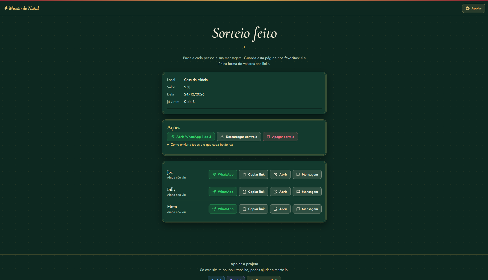
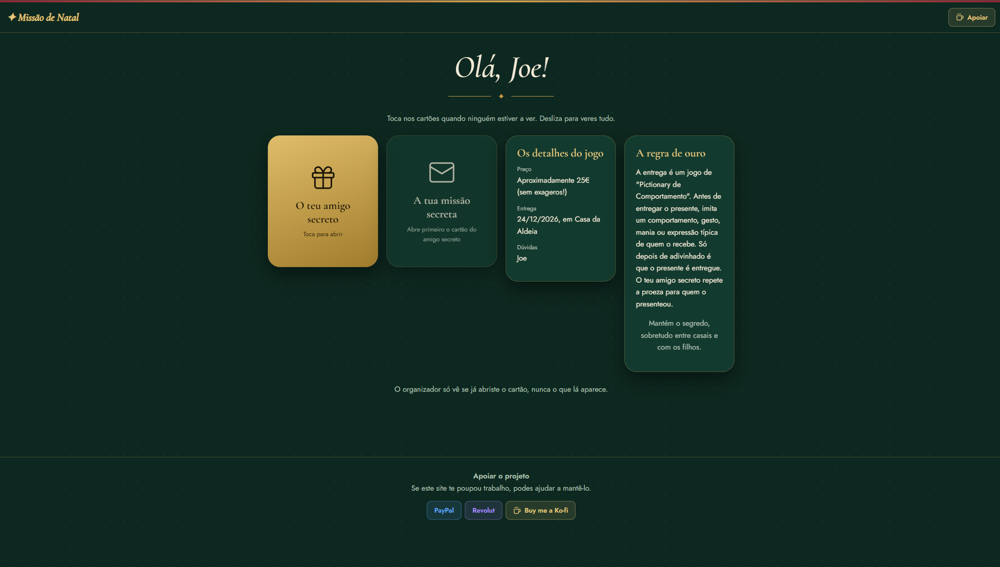
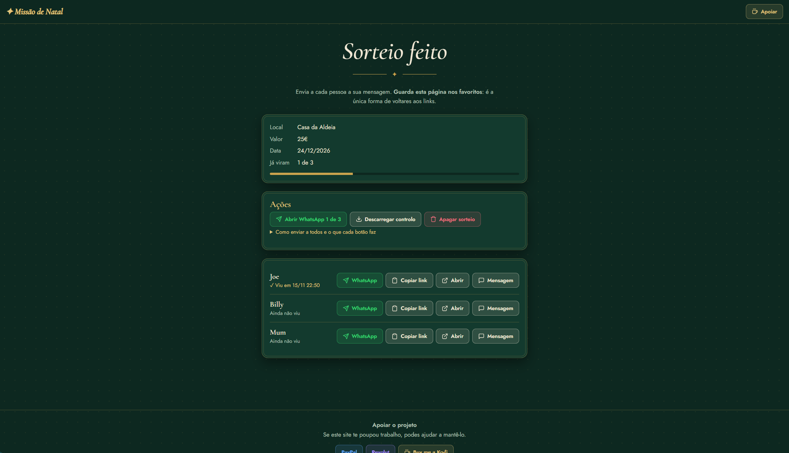

🇵🇹 [Versão portuguesa](README.md)
 
# 💌 SecretSanta – Christmas Mission
 
A website and backend for organising a **Secret Santa with secret missions**. The organiser enters the participants; the draw is made immediately and each person receives a **personal link** via WhatsApp, where they see their secret friend, their mission and the event details. Nobody (not even the organiser) sees who anyone else drew.
 
## Features
- Load participants from a file (.json or .txt with lines `Name; phone; mission; group`) directly in the browser.
- Web form: participants (name, phone), place, amount, date and who answers questions.
- Mission per person: **with**, **without** or **random** (50%). Missions come from `missaoSecreta.json` and are never repeated.
- Groups (couples, families): people in the same group do not draw each other. Nobody draws themselves.
- A ready-made WhatsApp message per person (`wa.me`), with a link to their personal page.
- Control file (`ficheiro_controlo.txt`) with who drew whom, kept only on the server, for the controller.
- Header with links to support the project (Revolut / Buy Me a Coffee).
## Missions: with, without or random
A mission is an extra challenge, picked at random from `missaoSecreta.json` and never repeated. **With mission**: the person always gets one. **Without mission**: never gets one. **Random (50%)**: the system decides by chance whether the person gets one. This is independent of who draws whom.
 
## Structure
```
app.py                 Flask backend (API + pages)
secret_santa/core.py   Draw, missions, message, storage
SecretDistribution.py  Terminal mode, no website
static/                Front-end (index, admin, reveal)
missaoSecreta.json     List of missions (theme, mission, example)
exemplo_participantes.json  Example for terminal mode
.env.example           Configuration (copy to .env)
```
Draws are stored in `data/` and the control file in `ficheiro_controlo.txt`. Both are in `.gitignore`.
 
## Installation
```bash
pip install -r requirements.txt
cp .env.example .env      # edit the values
python app.py             # http://localhost:5000
```
Production: `gunicorn app:app` behind your domain with HTTPS and `LINK_DOMINIO` set, so the links in the messages are correct.
 
## Usage
1. Open the site, fill in the event and the participants and click **Sortear e gerar links** (draw and generate links).
2. On the next page, click **Enviar no WhatsApp** (send on WhatsApp) for each person. **Bookmark the page**.
3. Each person opens their link, taps the tag and sees their secret friend and their mission.
4. Controller: check `ficheiro_controlo.txt` on the server.
### Terminal mode (no website)
Create `listNames.json` (see `exemplo_participantes.json`; `missao`: `sim`, `nao` or `aleatorio`; `grupo` optional) and run:
```bash
python SecretDistribution.py            # prints the WhatsApp links
python SecretDistribution.py --enviar   # sends via WhatsApp Web (requires pywhatkit)
```
 
## Configuration (`.env`)
| Variable | Description |
|---|---|
| `LOCAL_JANTAR`, `VALOR_PRESENTE`, `DATA_ENTREGA`, `CONTACTO` | Default values for the form and the message (place, amount, date, contact person) |
| `LINK_DOMINIO` | Public domain of the site |
| `INDICATIVO_PAIS` | Country code for 9-digit numbers (default `351`) |
| `SENHA_CRIAR` | Password required to create draws (empty = anyone can) |
| `APOIO_PAYPAL`, `APOIO_REVOLUT`, `APOIO_BUYMEACOFFEE` | Links for the "Support" window in the header (empty = hidden) |
| `DATA_DIR`, `FICHEIRO_MISSOES`, `FICHEIRO_CONTROLO`, `FICHEIRO_NOMES` | File paths |
 
## Invitation status
On the admin page you can see who has already tapped the tag (and when), without seeing the name they drew.
 
## Links in the messages
`LINK_DOMINIO` must be an address your guests can reach. `localhost` only works on your own computer. To test, use a tunnel (e.g. Cloudflare Tunnel or ngrok) and put that address in `.env`.
 
## Publishing at secretsanta.marioc.eu (Cloudflare Tunnel, free)
GitHub stores the code but does not run Python. The site runs on your computer (or on a server of yours) and Cloudflare provides the address and HTTPS:
1. Have the domain's DNS on Cloudflare. In the Zero Trust dashboard → Networks → Tunnels, create a tunnel and install `cloudflared` with the command Cloudflare shows you.
2. Add a route: `secretsanta` + `marioc.eu` → service `http://localhost:5000`.
3. In `.env`: `LINK_DOMINIO="https://secretsanta.marioc.eu"`, `TRUST_PROXY="1"`, `HOST="127.0.0.1"`, `CARREGAR_LISTA="0"` and a `SENHA_CRIAR`.
4. Start with `waitress-serve --listen=127.0.0.1:5000 app:app` and keep the computer on while guests are using their links.
5. The `data/` folder is created automatically. Back it up before the event and delete the draws afterwards.
## APIs
 
All API responses are JSON (except the control file). Errors always have the form `{"erro": "message"}`. `<t>` is a token: the **admin token** (returned when the draw is created) or the **participant token** (the one in the `/s/<token>` link).
 
### Pages
| Method | Route | Description |
|---|---|---|
| GET | `/` | Page to create a draw |
| GET | `/admin/<t>` | Organiser page (links, status, actions) |
| GET | `/s/<t>` | Guest page (secret friend and mission cards) |
| GET | `/static/<file>` | Front-end files (`.js`, `.css`) |
 
### Endpoints
| Method | Route | Used by | Description |
|---|---|---|---|
| GET | `/api/config` | All pages | Defaults from `.env` (`local`, `valor`, `data`, `contacto`), `precisa_senha` and support links (`paypal`, `revolut`, `bmc`) |
| POST | `/api/sorteios` | Home page | Creates the draw. Returns `201` with `{"admin_token": "..."}` |
| GET | `/api/admin/<t>` | Admin | Draw data: `id`, `config` and `participantes` (`nome`, `link`, `whatsapp`, `mensagem`, `visto`). Does not include who drew whom |
| GET | `/api/admin/<t>/controlo` | Admin | Downloads `controlo_<id>.txt` (text) with who drew whom in this draw |
| DELETE | `/api/admin/<t>` | Admin | Deletes all data of the draw. Returns `{"ok": true}` |
| GET | `/api/reveal/<t>` | Guest | Returns only `nome` and `config`. Does not reveal the secret friend |
| POST | `/api/reveal/<t>/abrir` | Guest | Reveals `amigo` and `missao` (`{missao, exemplo}` or `null`) and marks the person as "seen" |
| GET | `/api/participantes` | Home page | List from `FICHEIRO_NOMES`. Only answers if `CARREGAR_LISTA=1` and the request comes from the same computer, otherwise returns `[]` |
 
### Creating a draw (`POST /api/sorteios`)
```json
{
  "local": "Casa da Aldeia",
  "valor": "5€",
  "data": "24/12/2026",
  "contacto": "Maria Fernanda",
  "senha": "only if SENHA_CRIAR is set",
  "participantes": [
    {"nome": "Ana", "telefone": "+351912345678", "missao": "sim", "grupo": "casal1"},
    {"nome": "Rui", "telefone": "912345679", "missao": "aleatorio", "grupo": "casal1"}
  ]
}
```
`missao`: `sim` (yes), `nao` (no) or `aleatorio` (random). `grupo` is optional. Minimum 3 participants, maximum 200.
 
```bash
curl -X POST http://localhost:5000/api/sorteios -H "Content-Type: application/json" -d @request.json
```
 
### Response codes and limits
| Code | When |
|---|---|
| 200 / 201 | Success |
| 400 | Invalid request or participant, or a draw that is impossible with the given groups |
| 403 | Wrong creation password |
| 404 | Unknown token or route |
| 405 | Method not allowed |
| 413 | Request larger than 256 KB |
| 429 | Too many requests |
| 500 | Internal error (no details in the response) |
 
Limits: 240 requests per minute per IP on `/api/`, and `MAX_SORTEIOS_HORA` (default 20) draws created per hour per IP.
 
## Security (what is done and what is missing)
Done: random tokens of 96+ bits; no cookies (so no CSRF); text always escaped and a CSP with no inline scripts; size limits and per-IP request limits; atomic writes; server bound to `127.0.0.1` by default; errors without internal details; a button to delete the draw.
Missing (up to you): use **HTTPS** (proxy or Cloudflare Tunnel) with `TRUST_PROXY=1`; run with `gunicorn -w 1 --threads 8 app:app` (Linux) or `waitress-serve --listen=127.0.0.1:5000 app:app` (Windows), never with `app.py` in production; the data (names, phone numbers) is stored in `data/` as plain text, so protect the disk and delete it after the event. No penetration test has been done.
 
## Privacy
Each link has a random token that is hard to guess. The data (including phone numbers) stays only on your server. Delete `data/` after the event.
 
License: see `LICENSE`.
 

App
Page 1


Page 2


Page 3


Page 4


Page 5 - Admin
