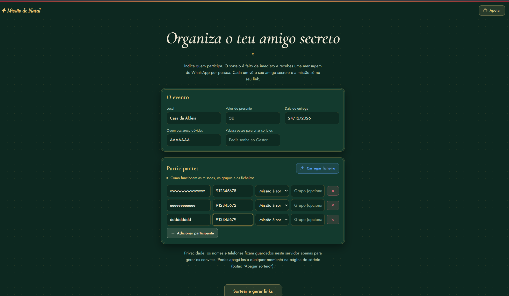
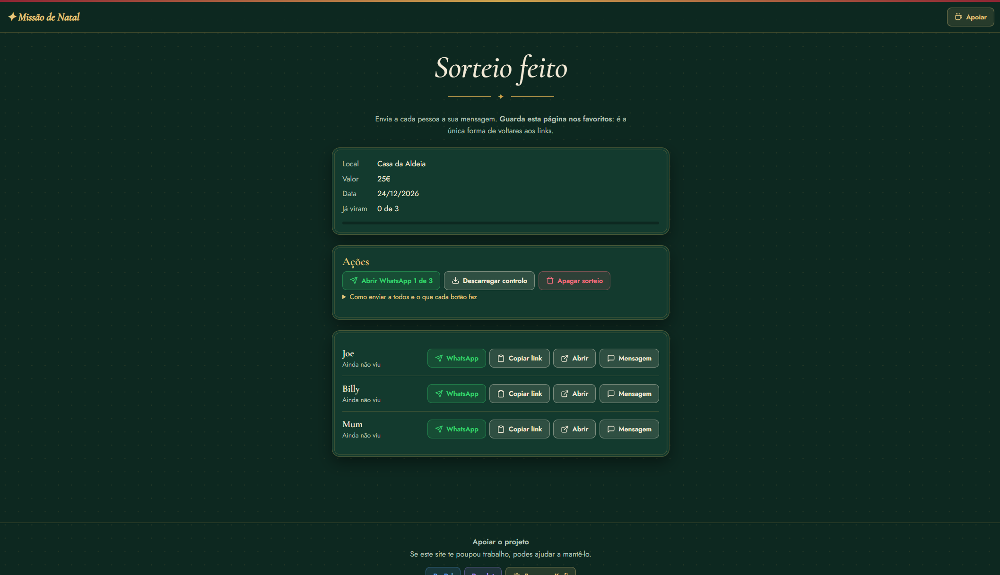
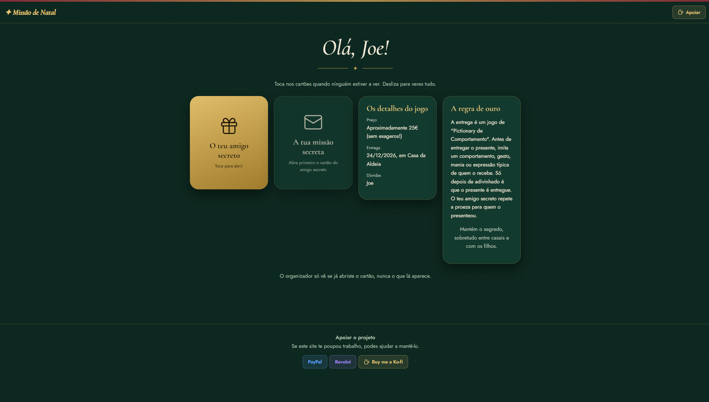
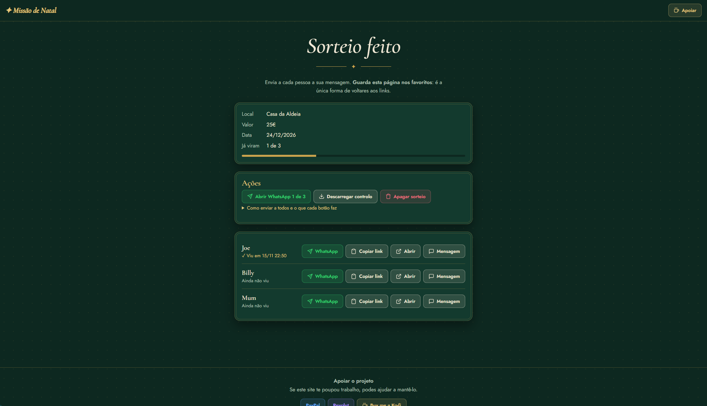

🇬🇧 [English version](README.en.md)
 
# 💌 SecretSanta – Missão de Natal
 
Site e backend para organizar um **amigo secreto com missões secretas**. Quem organiza indica os participantes; o sorteio é feito de imediato e cada pessoa recebe por WhatsApp um **link pessoal** onde vê o seu amigo secreto, a missão e os detalhes do evento. Ninguém (nem o organizador) vê o sorteio dos outros.
 
## Funcionalidades
- Carregar participantes de um ficheiro (.json ou .txt com linhas `Nome; telefone; missão; grupo`) no próprio browser.
- Formulário web: participantes (nome, telefone), local, valor, data e quem esclarece dúvidas.
- Missão por pessoa: **com**, **sem** ou **aleatória** (50%). As missões vêm de `missaoSecreta.json` e não se repetem.
- Grupos (casais, famílias): quem está no mesmo grupo não se tira. Ninguém tira a si próprio.
- Mensagem de WhatsApp pronta por pessoa (`wa.me`), com link para a página pessoal.
- Ficheiro de controlo (`ficheiro_controlo.txt`) com quem tirou quem, só no servidor, para o controlador.
- Cabeçalho com links para apoiar o projeto (Revolut / Buy Me a Coffee).
## Missões: com, sem ou à sorte
A missão é um desafio extra, escolhido ao acaso de `missaoSecreta.json` e nunca repetido. **Com missão**: recebe sempre uma. **Sem missão**: nunca recebe. **À sorte (50%)**: o sistema decide ao acaso se recebe ou não. É independente de quem tira quem.
 
## Estrutura
```
app.py                 Backend Flask (API + páginas)
secret_santa/core.py   Sorteio, missões, mensagem, armazenamento
SecretDistribution.py  Modo terminal, sem site
static/                Front-end (index, admin, reveal)
missaoSecreta.json     Lista de missões (tema, missao, exemplo)
exemplo_participantes.json  Exemplo para o modo terminal
.env.example           Configuração (copiar para .env)
```
Os sorteios ficam em `data/` e o controlo em `ficheiro_controlo.txt`. Ambos estão no `.gitignore`.
 
## Instalação
```bash
pip install -r requirements.txt
cp .env.example .env      # editar valores
python app.py             # http://localhost:5000
```
Produção: `gunicorn app:app` atrás do teu domínio com HTTPS e `LINK_DOMINIO` configurado, para os links nas mensagens estarem certos.
 
## Uso
1. Abre o site, preenche o evento e os participantes e clica em **Sortear e gerar links**.
2. Na página seguinte, clica em **Enviar no WhatsApp** para cada pessoa. **Guarda a página nos favoritos**.
3. Cada pessoa abre o link, toca na etiqueta e vê o amigo secreto e a missão.
4. Controlador: consulta `ficheiro_controlo.txt` no servidor.
### Modo terminal (sem site)
Cria `listNames.json` (ver `exemplo_participantes.json`; `missao`: `sim`, `nao` ou `aleatorio`; `grupo` opcional) e corre:
```bash
python SecretDistribution.py            # imprime os links de WhatsApp
python SecretDistribution.py --enviar   # envia via WhatsApp Web (requer pywhatkit)
```
 
## Configuração (`.env`)
| Variável | Descrição |
|---|---|
| `LOCAL_JANTAR`, `VALOR_PRESENTE`, `DATA_ENTREGA`, `CONTACTO` | Valores por defeito do formulário e da mensagem |
| `LINK_DOMINIO` | Domínio público do site |
| `INDICATIVO_PAIS` | Indicativo para números de 9 dígitos (por defeito `351`) |
| `SENHA_CRIAR` | Palavra-passe para criar sorteios (vazio = qualquer pessoa pode) |
| `APOIO_PAYPAL`, `APOIO_REVOLUT`, `APOIO_BUYMEACOFFEE` | Links da janela "Apoiar" no cabeçalho (vazio = oculto) |
| `DATA_DIR`, `FICHEIRO_MISSOES`, `FICHEIRO_CONTROLO`, `FICHEIRO_NOMES` | Caminhos de ficheiros |
 
## Estado dos convites
Na página de admin vês quem já tocou na etiqueta (e quando), sem ver o nome que lhe saiu.
 
## Links nas mensagens
O `LINK_DOMINIO` tem de ser um endereço acessível aos convidados. `localhost` só funciona no teu computador. Para testar, usa um túnel (ex.: Cloudflare Tunnel ou ngrok) e põe esse endereço no `.env`.
 
## Publicar em secretsanta.marioc.eu (Cloudflare Tunnel, grátis)
O GitHub guarda o código mas não executa Python. O site corre no teu computador (ou num servidor teu) e a Cloudflare dá-lhe o endereço e o HTTPS:
1. Domínio com o DNS na Cloudflare. No painel Zero Trust → Networks → Tunnels, cria um tunnel e instala o `cloudflared` com o comando que a Cloudflare mostra.
2. Adiciona uma rota: `secretsanta` + `marioc.eu` → serviço `http://localhost:5000`.
3. No `.env`: `LINK_DOMINIO="https://secretsanta.marioc.eu"`, `TRUST_PROXY="1"`, `HOST="127.0.0.1"`, `CARREGAR_LISTA="0"` e uma `SENHA_CRIAR`.
4. Arranca com `waitress-serve --listen=127.0.0.1:5000 app:app` e deixa o computador ligado enquanto houver convidados a usar os links.
5. A pasta `data/` é criada sozinha. Faz cópia de segurança antes do evento e apaga os sorteios depois.
## APIs
 
Todas as respostas da API são JSON (exceto o ficheiro de controlo). Os erros têm sempre o formato `{"erro": "mensagem"}`. `<t>` é um token: o **token de admin** (devolvido ao criar o sorteio) ou o **token do participante** (o que vem no link `/s/<token>`).
 
### Páginas
| Método | Rota | Descrição |
|---|---|---|
| GET | `/` | Página para criar um sorteio |
| GET | `/admin/<t>` | Página do organizador (links, estado, ações) |
| GET | `/s/<t>` | Página do convidado (cartões do amigo secreto e da missão) |
| GET | `/static/<ficheiro>` | Ficheiros do front-end (`.js`, `.css`) |
 
### Endpoints
| Método | Rota | Quem usa | Descrição |
|---|---|---|---|
| GET | `/api/config` | Todas as páginas | Valores por defeito do `.env` (`local`, `valor`, `data`, `contacto`), `precisa_senha` e links de apoio (`paypal`, `revolut`, `bmc`) |
| POST | `/api/sorteios` | Página inicial | Cria o sorteio. Devolve `201` com `{"admin_token": "..."}` |
| GET | `/api/admin/<t>` | Admin | Dados do sorteio: `id`, `config` e `participantes` (`nome`, `link`, `whatsapp`, `mensagem`, `visto`). Não inclui quem tirou quem |
| GET | `/api/admin/<t>/controlo` | Admin | Descarrega `controlo_<id>.txt` (texto) com quem tirou quem neste sorteio |
| DELETE | `/api/admin/<t>` | Admin | Apaga todos os dados do sorteio. Devolve `{"ok": true}` |
| GET | `/api/reveal/<t>` | Convidado | Devolve só `nome` e `config`. Não revela o amigo secreto |
| POST | `/api/reveal/<t>/abrir` | Convidado | Revela `amigo` e `missao` (`{missao, exemplo}` ou `null`) e regista a pessoa como "viu" |
| GET | `/api/participantes` | Página inicial | Lista do `FICHEIRO_NOMES`. Só responde se `CARREGAR_LISTA=1` e o pedido vier do próprio computador, senão devolve `[]` |
 
### Criar um sorteio (`POST /api/sorteios`)
```json
{
  "local": "Casa da Aldeia",
  "valor": "5€",
  "data": "24/12/2026",
  "contacto": "Maria Fernanda",
  "senha": "só se SENHA_CRIAR estiver definida",
  "participantes": [
    {"nome": "Ana", "telefone": "+351912345678", "missao": "sim", "grupo": "casal1"},
    {"nome": "Rui", "telefone": "912345679", "missao": "aleatorio", "grupo": "casal1"}
  ]
}
```
`missao`: `sim`, `nao` ou `aleatorio`. `grupo` é opcional. Mínimo de 3 participantes, máximo de 200.
 
```bash
curl -X POST http://localhost:5000/api/sorteios -H "Content-Type: application/json" -d @pedido.json
```
 
### Códigos de resposta e limites
| Código | Quando |
|---|---|
| 200 / 201 | Sucesso |
| 400 | Pedido ou participante inválido, ou sorteio impossível com os grupos dados |
| 403 | Palavra-passe de criação incorreta |
| 404 | Token ou rota inexistente |
| 405 | Método não permitido |
| 413 | Pedido maior que 256 KB |
| 429 | Demasiados pedidos |
| 500 | Erro interno (sem detalhes na resposta) |
 
Limites: 240 pedidos por minuto por IP em `/api/`, e `MAX_SORTEIOS_HORA` (20 por defeito) sorteios criados por hora por IP.
 
## Segurança (o que está feito e o que falta)
Feito: tokens aleatórios de 96+ bits; sem cookies (sem CSRF); texto sempre escapado e CSP sem scripts inline; limites de tamanho e de pedidos por IP; escritas atómicas; servidor só em `127.0.0.1` por defeito; erros sem detalhes internos; botão para apagar o sorteio.
Falta (é contigo): usar **HTTPS** (proxy ou Cloudflare Tunnel) com `TRUST_PROXY=1`; correr com `gunicorn -w 1 --threads 8 app:app` (Linux) ou `waitress-serve --listen=127.0.0.1:5000 app:app` (Windows), nunca com `app.py` em produção; os dados (nomes, telefones) ficam em `data/` em texto simples, por isso protege o disco e apaga depois do evento. Não foi feito teste de intrusão.
 
## Privacidade
Cada link tem um token aleatório difícil de adivinhar. Os dados (incluindo telefones) ficam só no teu servidor. Apaga `data/` depois do evento.
 
Licença: ver `LICENSE`.
 

App
Page 1


Page 2


Page 3


Page 4


Page 5 - Admin
